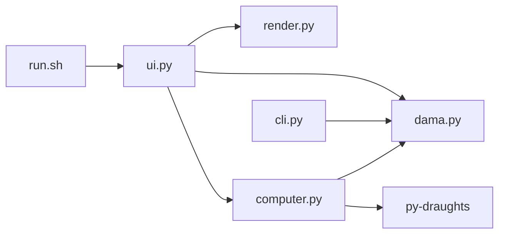

# Dama

İki kişiyle veya bilgisayara karşı oynanan dama oyunu. Python ve Tkinter ile çalışır.

## Başlatma

```sh
./run.sh
```

İlk çalıştırmada py-draughts paketi .venv içine kurulur. Sonraki açılışlarda internet gerekmez.

## Oynama

Bir taşa, sonra işaretli kareye tıkla. Zincirleme almada her varış karesine sırayla tıkla. Yeni oyun, geri al ve menü düğmeleri oyun ekranındadır.

Bilgisayara karşı oyunda kırmızı taşlar oyuncudadır. Kolay, orta ve zor seviye başlangıç ekranından seçilir.

## Proje mimarisi



Kurallar ve oyun durumu dama.py içindedir. computer.py indirilen motorun hamlesini oyuna aktarır. ui.py tıklamaları ve animasyonu yönetir. render.py ekranı çizer. cli.py terminalden oynamayı sağlar.

## Kurallar

Kırmızı başlar. Her oyuncunun on iki taşı vardır. Taşlar çapraz ilerler. Alma zorunludur. Zincirleme alma tamamlanır. Son sıraya ulaşan taş dama olur. Hamlesi kalmayan oyuncu kaybeder.

## Test

```sh
.venv/bin/python -m unittest -v
```

Bilgisayar motoru [py-draughts](https://github.com/miskibin/py-draughts) projesinden gelir. Paket GPL 3 lisanslıdır.
