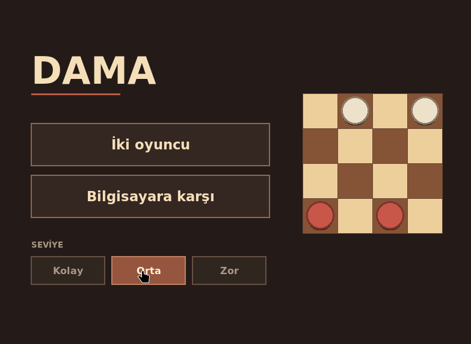
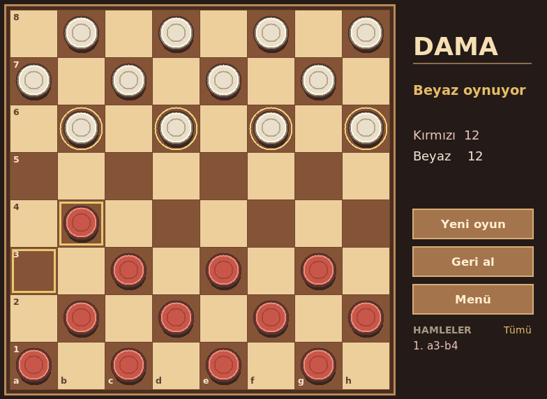
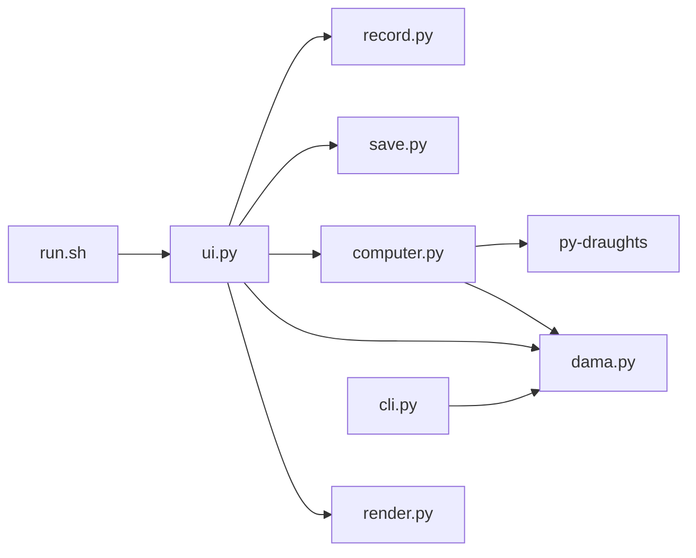

# Dama

İki kişiyle veya bilgisayara karşı oynanan İngiliz daması. Python ve Tkinter ile çalışır.

## Başlatma

```sh
./run.sh
```

İlk çalıştırmada py-draughts paketi .venv içine kurulur. Sonraki açılışlarda internet gerekmez.

## Oynama

Bir taşa, sonra işaretli kareye tıkla. Aynı taşla birden fazla taş alırken her varış karesine sırayla tıkla. Yeni oyun, geri al ve menü düğmeleri oyun ekranındadır. Son hamleler sağda görünür. Tümü düğmesi bütün hamleleri açar. Listeden bir hamle seçerek tahtayı o andaki haliyle görebilirsin. PDN kaydet düğmesi oyunu dosyaya yazar.

Bilgisayara karşı oyunda kırmızı taşlar oyuncudadır. Kolay, orta ve zor seviye başlangıç ekranından seçilir. Tema da başlangıç ekranından seçilir. Oyun her hamleden sonra kaydedilir. Devam et düğmesi kayıtlı oyunu açar. Biten oyun Son oyunu aç düğmesiyle yeniden incelenebilir. Oyun bitince sonuç ve yeniden oynama düğmesi görünür.

## Görseller





## Proje mimarisi



Kurallar ve oyun durumu dama.py içindedir. computer.py indirilen motorun hamlesini oyuna aktarır. ui.py tıklamaları ve animasyonu yönetir. render.py ekranı çizer. save.py oyunu kaydeder ve açar. record.py PDN kaydını oluşturur. cli.py terminalden oynamayı sağlar.

## Kurallar

Kırmızı başlar. Her oyuncunun on iki taşı vardır. Taşlar çapraz ilerler. Alma zorunludur. Bir taşı aldıktan sonra aynı taşla başka bir taş alabiliyorsan devam etmelisin. Son sıraya ulaşan taş dama olur. Hamlesi kalmayan oyuncu kaybeder. Aynı konum üçüncü kez oluşursa oyun berabere biter. İki oyuncu da kırk hamle boyunca taş almadan ve normal taş ilerletmeden oynarsa oyun berabere biter.

## Eklemeler

[Araştırma ve uygulama listesi](EKLEMELER.md).

## Test

```sh
.venv/bin/python -m unittest -v
```

Bilgisayar motoru [py-draughts](https://github.com/miskibin/py-draughts) projesinden gelir. Paket GPL 3 lisanslıdır.
